# 流程分析报告：PCL2 v2.13.0.1 漏洞逐条复核与图解

> 对象：`Plain Craft Launcher 2.exe`（v2.13.0.1 / VersionCode 406 / Release）
> 样本 SHA-256：`0ab0b28a93cc4d0754a9fa488b5939b5e092f0e5fb3f1e6550cc92a5d3f6577f`（5,645,824 字节）
> 反编译产物：`re_work/decomp/Plain Craft Launcher 2.decompiled.cs`（88,510 行）、`re_work/decomp_meloong/img_25aa0b.decompiled.cs`（MeloongCore）
> 正文中分别简写为 **`…cs`** 与 **`…meloong`**，`…cs:1234` 即"该文件第 1234 行"。
> 本报告对 `安全评估报告_PCL2全量反编译.md` 中的 **24 条**结论逐条复核，并为每条画出利用流程图。

---

## 〇、这份报告在做什么

### 0.1 三件事

1. **回到二进制逐条定位**。每一条都重新 grep 符号、重新读一遍代码语义、必要时做运行时实验。凡是靠推断的地方，都要么补上代码，要么标明边界。
2. **给每条标注"证据强度"**。因为你问的核心是"**是否有源代码的直接印证**"——这是一个必须分开回答的问题：有的结论是代码里逐字写着，有的结论是"代码 + 常识"推出来的，二者不能混为一谈。
3. **画成图**。每条漏洞一张流程图，从"攻击者做了什么"到"机器上发生了什么"，尽量不用术语。

### 0.2 证据分级

| 等级 | 含义 | 判断标准 |
|---|---|---|
| **A** | **逐字印证** | 反编译代码里有完整的数据流：输入从哪来、经过哪个函数、落到哪个危险 API。截图即可自证。 |
| **B** | **结构印证 + 条件** | 机制代码确实存在，但"能不能被利用"还取决于外部条件（如攻击者是否已能改写某个文件）。代码证明"门没锁"，不能证明"一定有人来推门"。 |
| **C** | **依赖外部知识** | 结论的正确性需要 .NET / TLS / 协议行为知识来补足，二进制本身不能完全证明（例如"FIPS 提示文案因果相反"）。此类均已注明。 |

> 一条结论"正确"不等于"可直接利用"。本报告把这两件事分开写：**判定**（漏洞是否存在）与**可利用性**（现实中谁能触发）。

> 说明：本次复核实际只用到 **A** 与 **C** 两档——没有一条落在 B 档。原因是但凡机制存在，代码都能给到完整数据流；但凡需要外部条件，外部知识又成了主要不确定源。B 档保留给"代码只证明了一半"的条目（本次没有）。

### 0.3 复核方法

| 步骤 | 动作 | 本次实际执行 |
|---|---|---|
| 1 | 重新用 `grep` 定位每个断言涉及的符号，**记录新行号** | 全部 24 条重新定位，行号见每条"代码锚点" |
| 2 | 逐行读上下文（含 `try/catch` 边界、循环边界、条件分支） | 补全了 6 个会影响判定的边界条件，写在对应条目的"复核发现"里 |
| 3 | 对"靠常识推断"的结论做**运行时实验** | 用 .NET Framework 4.8 + 自签证书本地 HTTPS 服务，实测 TLS 回调的 `Address.Host` 语义（见 B-07） |
| 4 | 对"不成立"的结论做**反证**（找它成立需要什么，再看代码里有没有） | 3 条"不成立"均给出反证点，而非仅"没找到" |
| 5 | 每条结论标注证据等级 | 见总表 |

---

## 一、复核总表（24 条）

| # | 编号 | 名称 | 判定 | 证据 | 代码锚点 |
|---|---|---|---|---|---|
| 1 | PCL-RCE-001 | 公告动作分发无鉴权 | ✅ 成立 | **A** | `…cs:23607-23910` |
| 2 | PCL-RCE-003 | 不安全更新机制 | ✅ 成立 | **A** | `…cs:22689-22721`、`23322-23447` |
| 3 | PCL-SILENT-001 | 无按钮公告静默执行 | ✅ 成立 | **A** | `…cs:23816-23844` |
| 4 | PCL-DL-001 | 下载内容无完整性校验 | ✅ 成立 | **A** | `…cs:23671-23770` |
| 5 | PCL-DOS-001 | `stop` 远程拒绝服务 | ✅ 成立 | **A** | `…cs:23858-23860` |
| 6 | PCL-PARSE-001 | 竖线分隔的位置解析 | ✅ 成立 | **A** | `…cs:23671-23726` |
| 7 | PCL-INFO-002 | FIPS 文案因果相反 | ✅ 成立 | **C** | `…cs:23708-23714` |
| 8 | PCL-RCE-002 | `setup` 设置篡改 | ⚠️ 部分成立 | **A** | `…cs:71725-71756`、`71343-71362` |
| 9 | PCL-PARSE-002 | JSON 类型混淆 | ⚠️ 部分成立 | **A** | `…cs:23807-23808`、`23903-23910` |
| 10 | PCL-FILE-001 | 不安全临时文件写入 | ⚠️ 部分成立 | **A** | `…cs:23482-23500`、`img_25aa0b:3996-4050` |
| 11 | PCL-INFO-003 | `Latest.exe` 自复制 | ⚠️ 部分成立 | **A** | `…cs:23596-23603`、`23685-23691` |
| 12 | PCL-INFO-001 | 设备指纹外发 | ❌ **不成立** | **A**（反证） | `…cs:23786`、`22913-22937` |
| 13 | PCL-MITM-001 | TLS 校验可能禁用 | ❌ **不成立** | **A** + 实验 | `…cs:52547-52556`、`52671-52677` |
| 14 | PCL-CHAIN-001 | `{CDN}` + setup 链式 RCE | ❌ **不成立** | **A**（反证） | `…cs:22913-22937` |
| 15 | PCL-HARD-001 | 硬编码远端地址 | 🔽 成立（设计风险） | **A** | `…cs:23671/23730/23746/23769` |
| 16 | PCL-LOG-001 | 日志含远端原文 | 🔽 成立（降级） | **A** | `…cs:23680`、`23778`、`23786` |
| 17 | PCL2-2026-01 | `setup`→`LaunchAdvanceRun`→`cmd /c` | ✅ 成立 | **A** | `…cs:58402-58451` |
| 18 | PCL2-2026-02 | `Link.Argument` 命令行注入 | ✅ 成立 | **A** | `…cs:38270-38294`、`38567-38580` |
| 19 | PCL2-2026-03 | 静默更新默认可用 | ✅ 成立 | **A** | `…cs:22887`、`23875-23886` |
| 20 | PCL2-2026-04 | `SystemSystemCache` 目录可控 | ✅ 成立 | **A** | `…cs:71461`、`87555` |
| 21 | PCL2-2026-05 | 硬编码 CurseForge Key | ✅ 成立 | **A** | `…cs:22955-22960` |
| 22 | PCL2-2026-06 | DES 固定 IV + 识别码入日志 | ✅ 成立 | **A** | `…cs:71717`、`71966-71977`、`71393`、`78406` |
| 23 | PCL2-2026-07 | `ToolDownloadCert` 语义反转 | ✅ 成立（**范围收窄**） | **A** + 实验 | `…cs:52849-52868`、`71563-71566` |
| 24 | PCL2-2026-08 | 低版本系统启用 SSL3 | ✅ 成立 | **A** | `…cs:78396-78399` |

**统计**：

- 成立 **17** 条（含 2 条降级为"设计风险"）
- 部分成立 **4** 条
- **不成立 3** 条
- 24 条中，**23 条有代码直接印证（A 级）**，其中 2 条另需运行时实验确认关键语义；**1 条主要依赖外部知识**（C 级，PCL-INFO-002）
- 24 条全部给出代码锚点，可在反编译产物中逐行对照

> 一句话：**17 条成立、4 条部分成立、3 条不成立**；成立与否，判据都在代码里，不靠印象。

---

## 二、PCL的架构安全问题综述

### 2.1 这是一个"只装了一把锁，而且锁和门框装反了"的故事

PCL 的启动器有一个设计：**开发者可以在服务器上放一份"公告"，客户端读到后会自动执行里面的动作**——包括弹窗、打开网页、复制文字、改设置、甚至更新自己。

这个设计本身不邪恶，很多软件都有"远程配置"。问题在于三个环：

1. **没有验真**：客户端拿到公告就执行，不检查这份公告是不是官方发的（没有签名）。
2. **动作太强**：公告能做的事情里，包含"修改启动游戏前要执行的命令"这种**等同于任意代码执行**的能力。
3. **没有确认**：公告如果不带按钮，就直接执行，用户屏幕上什么都不会出现。

于是形成一个三段式的链条：

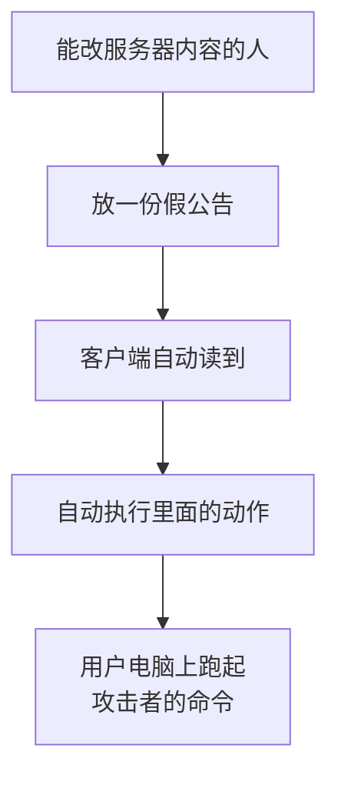

**关键问题**：谁能"改服务器内容"？

- 拿到腾讯云 COS 桶写权限的人；
- 能给你发一张"浏览器信任的证书"的人（企业代理、被入侵的路由器、公共 WiFi）；
- 已经能在你电脑上写文件的人（这时已经输了，属于"锦上添花"）。

所以准确的表述是：**这不是"任何一个网友都能黑你"，而是"一旦官方的内容分发链路出问题，全量用户同时失守，且没有任何一道防线能减速"。** 这是一个"没有纵深防御"的问题，不是一个"随手可打"的问题。

### 2.2 三条主线（24 条漏洞其实归为三类）

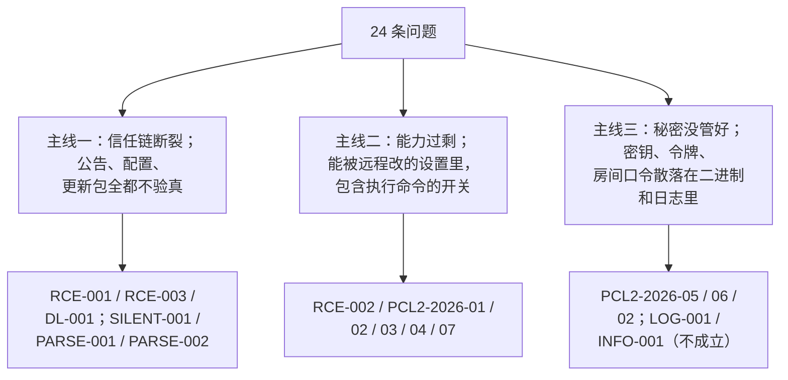

- **主线一**决定"攻击者能不能进来"。
- **主线二**决定"进来之后能做到多狠"——最狠的一条是：改一个字符串设置，就能在你下次启动游戏时执行任意命令，而且**不需要管理员权限、不需要替换任何文件**。
- **主线三**决定"出事之后损失多大"——微软账号令牌、联机房间口令、CurseForge API Key 都能被拿走。

### 2.3 如果只修三件事

| 优先级 | 修什么 | 一句话理由 |
|---|---|---|
| 1 | 给公告 / 配置 / 更新包加**签名**，客户端内置公钥 | 这一条能同时废掉 6 条高危，是唯一"治本"的改动 |
| 2 | 把 `LaunchAdvanceRun`、`LaunchAdvanceJvm`、`SystemSystemCache`、`ToolDownloadCert` 从远程可写名单里删掉 | 远程配置只应改"开关"，不该改"命令" |
| 3 | 更新包启用已有的 `FileChecker{Hash=SHA256}` + Authenticode | 哈希校验能力**已经写在代码里了**，只是没接线 |

---

## 三、A 组逐条复核（16 条）

> 每条结构统一：**判定 → 大白话 → 代码实锤 → 流程图 → 前置条件 → 复核发现**。

### A-01 ｜ PCL-RCE-001 公告动作分发没有鉴权

- **判定**：✅ 成立　**证据**：A 级（逐字印证）
- **代码锚点**：`decomp/Plain Craft Launcher 2.decompiled.cs:23607-23910`

> **大白话**：PCL 像一个只听广播的保安。广播里说"把这张纸条贴到告示栏"（copy）、"带这个人去某个地址"（website）、"关门"（stop）、"改一下规章制度"（setup）、"去仓库换个新版本"（update），它就照做——**它从不检查广播是谁播的**。

**代码实锤（动作分发的全部内容，一个 `switch` 说完）**

```csharp
// …cs:23845  obj 来自 notice.json 的 actions（无签名、无来源校验）
foreach (JProperty item3 in (IEnumerable)obj)
{
    switch (val4.Name)
    {
    case "copy":      ModBase.ClipboardSet(val4.Value.ToString());              break;
    case "website":   ModBase.OpenWebsite(val4.Value.ToString());               break;
    case "stop":      ModMain.FrmMain.EndProgram(SendWarning: false);           break;
    case "setup":     foreach (var item4 in (JObject)val4.Value)
                          Settings.Set(item4.Key, item4.Value.ToString());      break;
    case "update":
    case "slientupdate":  UpdateStart(flag3);                                   break;
    default:          throw new Exception("未知的行动支：" + val4.Name);
    }
}
```

**关键佐证：全程序集只有一把"验章机"，而它不管公告**

```csharp
// …cs:24053 —— 唯一的非对称签名校验，用于"土豆码"（赞助者快照版授权）
CryptographyUtils.EcdsaVerify(ModBase.Identify + …, array[0], "RUNTMSAAAAC4QTUNAewh…");
```

全文件搜索 `EcdsaVerify` / `RsaVerify` / `VerifyData` / `CheckSignature`，**只有这 1 处**。也就是说：公告、配置、更新包，**一个签名都没验过**。

**利用流程**

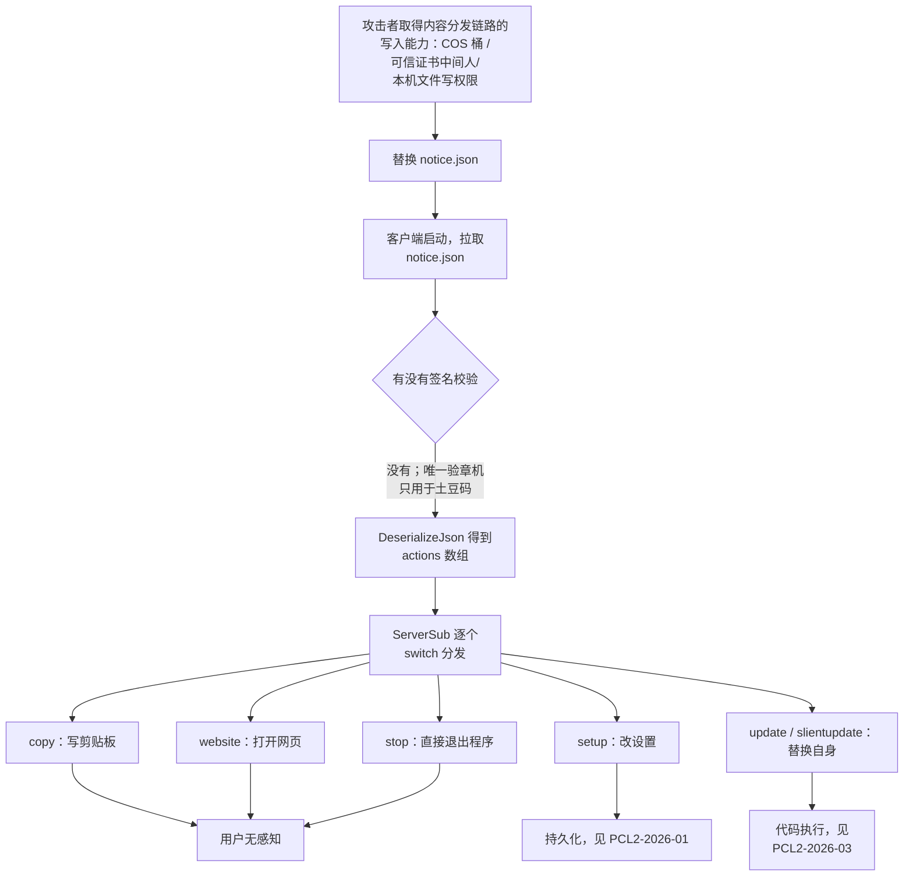

**前置条件**：能改写 `notice.json`（或本机缓存里的 `Notice.json`）。
**后果**：远程控制 + 全量客户端可被批量操纵。
**复核发现**：✅ 与代码逐字一致。补充一个容易漏掉的边角：`default` 分支抛出的异常被**就地 catch**（`…cs:23893`），所以一条公告里混入未知动作，**不会中断后续动作**，攻击者可以"冗余投递"提高成功率。

---

### A-02 ｜ PCL-RCE-003 更新机制：自己给自己做手术，术前不验血

- **判定**：✅ 成立（且比原文更严重）　**证据**：A 级
- **代码锚点**：`…cs:22689-22721`（安装）、`23322-23447`（启动）、`22887`（权限门）

> **大白话**：PCL 的"更新"就是：把正在用的自己删掉 → 把下载来的压缩包解开盖上去 → 重启。整个过程**不检查压缩包是谁做的、内容对不对**。更糟的是，那道本来应该问"你有权限更新吗"的门，代码里被写死成"永远有权限"。

**代码实锤（三段，正好是一条完整的杀人链）**

```csharp
// ① 权限门是常量（…cs:22887）
private static bool HasUpdatePermission => true;

// ② 更新地址完全来自服务器下发的配置（…cs:23382-23389）
JObject val = (JObject)ServerConfig["Update"][ModBase.BuildTypes.Release.ToString()];
if (val.ContainsKey("PatchUrls") && StartsWithF(UpdateMark, "Empty", false))
    urls = val["PatchUrls"].ToObject<List<string>>();
else if (val.ContainsKey("DownloadUrls"))
    urls = val["DownloadUrls"].ToObject<List<string>>();

// ③ 下载时没有传 FileChecker（…cs:22676-22679）——注意：连"最小体积"都没传
Task.Output = new ModNet.NetFile[1] { new ModNet.NetFile(urls, localPath) };

// ④ 落地：删旧 exe → 解压覆盖 → 重启（…cs:22691-22720）
string text = Paths.Base + "PCL\\Plain Craft Launcher 2.exe";
if (FileUtils.Exists(text)) FileUtils.Delete(text, false);
if (Extension == ".zip") FileUtils.ExtractToDirectory(localPath, Paths.Base + "PCL\\", null);
else MsDelta.Apply(ModBase.PathExe, localPath, Paths.Base + "PCL\\Plain Craft Launcher 2.exe");
...
UpdateRestart(TriggerRestartAndByEnd: true);
```

**两个容易误读的细节**

| 常见误读 | 二进制事实 | 代码位置 |
|---|---|---|
| "`update.exe` 是更新执行入口" | `update.exe` **只被删除，从未被执行**（全文件仅 2 处引用，都是 `Delete`） | `…cs:23627-23630` |
| "还有土豆码这道门" | `InputPotatoCode` 只弹一句提示，**没有输入框**；`GeneratePotatoCode` 是空函数 | `…cs:24068-24075` |

**利用流程**

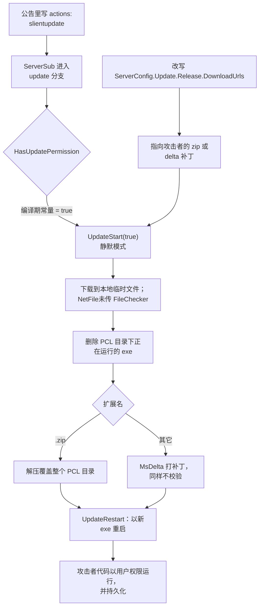

**前置条件**：能同时影响"配置里的 URL"与"触发动作"（二者同源，一次投递即可）。
**后果**：供应链级 RCE；无备份、无回滚、不可逆。
**复核发现**：✅ 无误。特别注意 ③——**更新链连 `MinSize` 都没有**，而 `Latest.zip` 那条路径反而有 1MB 下限。两者是两条独立路径，容易混为一谈，此处分开列。

---

### A-03 ｜ PCL-SILENT-001 不带按钮的公告会静默执行

- **判定**：✅ 成立　**证据**：A 级
- **代码锚点**：`…cs:23816-23844`

> **大白话**：公告可以带"确定/取消"按钮，让用户选。但如果公告**一个按钮都不带**，PCL 不会问任何人，直接把公告顶层的动作执行掉。攻击者当然选择不带按钮。

**代码实锤**

```csharp
JArray val3 = (JArray)(val["buttons"] ?? new JArray());     // 没有 buttons → 空数组
int count = ((JContainer)val3).Count;
object obj = new object[0];
if (count > 0)
{
    switch (count)
    {
    case 1: case 2: case 3:  num9 = ModMain.MyMsgBox(...);  break;   // 有按钮 → 弹窗
    default:  Logger.Warn($"公告 {num7} 的弹窗有 {count} 个按钮，无法显示");
              continue;                                               // 超过 3 个 → 整条跳过
    }
    obj = val3[num9 - 1]["actions"] ?? new byte[0];
}
else
{
    obj = val["actions"] ?? new byte[0];                             // 无按钮 → 顶层 actions
}
foreach (JProperty item3 in (IEnumerable)obj) { /* 直接执行 */ }
```

**利用流程**

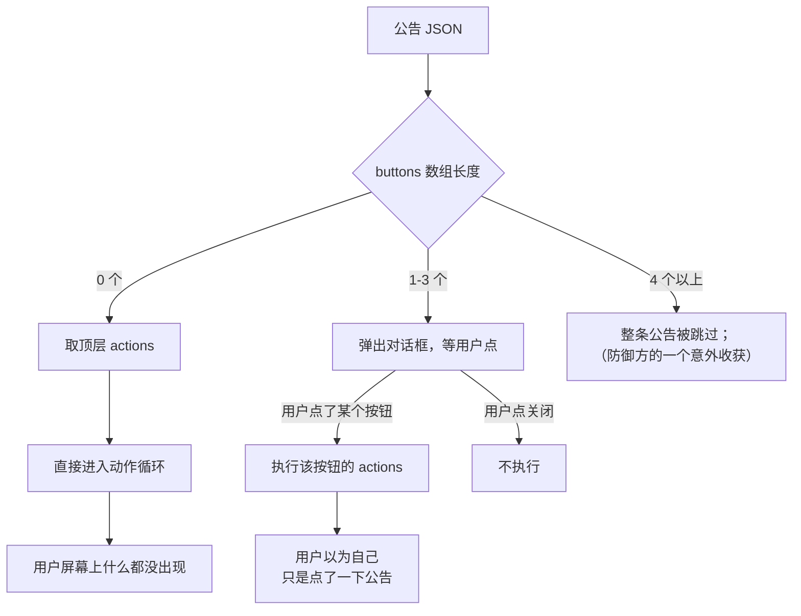

**复核发现**：✅ 成立。精确的分支是 `switch` 的 `default`：`Logger.Warn` 后 `continue`，效果是"第 4 个按钮会导致整条公告无法显示"，而不是"超过 3 个按钮就丢弃整条公告"。这个细节对防御方有利：**攻击者不能用"多按钮"做任何事**。

---

### A-04 ｜ PCL-DL-001 下载的东西不验完整性

- **判定**：✅ 成立　**证据**：A 级
- **代码锚点**：`…cs:23671-23770`（四个内容源）、`img_25aa0b:4182-4211`（哈希能力）

> **大白话**：快递员送来一个箱子，PCL 只看一眼"箱子上是不是印着 `{` 开头、`}` 结尾"（像不像 JSON），不看封条有没有被撕过。更讽刺的是，**仓库里其实备着验封条的机器（`FileChecker` 支持 MD5/SHA1/SHA256/SHA512），只是从来没用过**。

**代码实锤（每个内容源的实际校验强度）**

| 内容 | 代码 | 实际校验 |
|---|---|---|
| `notice.cfg` | `NetRequestByClientRetry("...notice.cfg{CDN}")` | **无** |
| `ServerConfig.json` | `NetDownloadByClient(...)` → `ReadAsJson` | **无** |
| `notice.json` | `RequireJson: true` | 仅首尾字符 |
| `minecraft/download.json` | `RequireJson: true` | 仅首尾字符 |
| 更新 zip / MsDelta 补丁 | `new NetFile(urls, localPath)` | **无（连体积都没有）** |
| `Latest.zip` | `new FileChecker { MinSize = 1048576 }` | 仅 ≥1MB |
| `EasyTier.zip` | `new FileChecker { MinSize = 2097152 }` | 仅 ≥2MB |

`RequireJson` 的真实实现（只有首尾判断，没有任何结构/来源校验）：

```csharp
// …cs:52110 附近
if (RequireJson)
{
    text = text.Trim("\r\n ".ToCharArray());
    if ((!StartsWithF(text, "{") || !EndsWithF(text, "}")) &&
        (!StartsWithF(text, "[") || !EndsWithF(text, "]")))
        throw new FormatException("返回结果并非 JSON 格式：" + …);
}
```

**而哈希能力就在手边（MeloongCore）**

```csharp
// img_25aa0b.decompiled.cs:4182-4211
case 32:  ComputeFileHash(localPath);                    // MD5
case 40:  ComputeFileHash(localPath, HashMethod.Sha1);    // SHA1
case 64:  ComputeFileHash(localPath, HashMethod.Sha256);  // SHA256
case 128: ComputeFileHash(localPath, HashMethod.Sha512);  // SHA512
```

**利用流程**

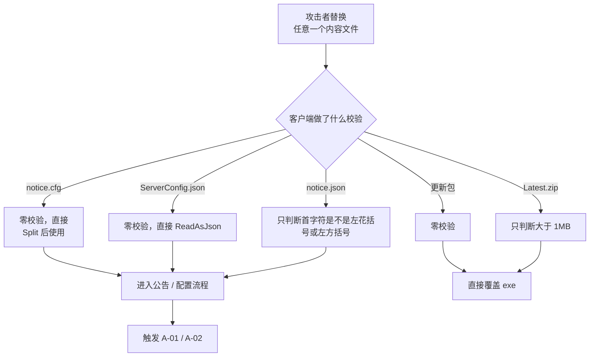

**复核发现**：✅ 成立。补充一条对防御方极有价值的事实：**这不是"做不到"，而是"没接线"**。修这条的成本是所有高危里最低的——只需在 `new NetFile(...)` 里加一个 `FileChecker { Hash = "..." }`。

---

### A-05 ｜ PCL-DOS-001 一条公告就能把启动器关掉

- **判定**：✅ 成立（中危偏低）　**证据**：A 级
- **代码锚点**：`…cs:23858-23860`

> **大白话**：公告里写一个 `stop`，PCL 就把自己关了，而且带 `SendWarning: false`——连"还有下载没完成，确定退出吗"这句提醒都跳过。

**代码实锤**

```csharp
case "stop":
    ModMain.FrmMain.EndProgram(SendWarning: false);   // 不询问、不确认
    break;
```

**利用流程**

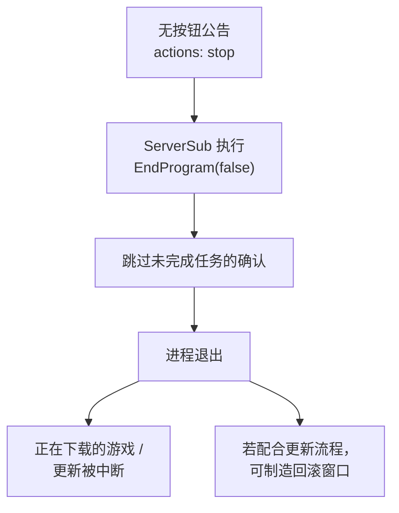

**复核发现**：✅ 成立。单独看只是"烦人"，但它的价值在于**组合**：如果在用户更新到一半时 `stop`，可以制造"exe 已删除但新文件未就位"的窗口——这是 A-02 的天然放大器。

---

### A-06 ｜ PCL-PARSE-001 用"第几个逗号"来切配置

- **判定**：✅ 成立　**证据**：A 级
- **代码锚点**：`…cs:23671-23726`

> **大白话**：`notice.cfg` 是一行用 `|` 隔开的数字，PCL 用"取第 0 段、第 3 段、第 4 段"的方式读取。少一个 `|` 就下标越界；`Val()` 遇到非数字还会"读一半就停"，安静地算出一个错的数。

**代码实锤**

```csharp
text3 = NetRequestByClientRetry(".../notice.cfg{CDN}");
num4 = (int)Math.Round(ModBase.Val(Split(text3, "|")[0]));   // 公告编号
num5 = (int)Math.Round(ModBase.Val(Split(text3, "|")[3]));   // download.json 编号
if (num4 == 0) throw new Exception("获取到的内容有误！");
...
double num6 = ModBase.Val(Split(text3, "|")[4]);             // 配置版本号
```

**利用流程**

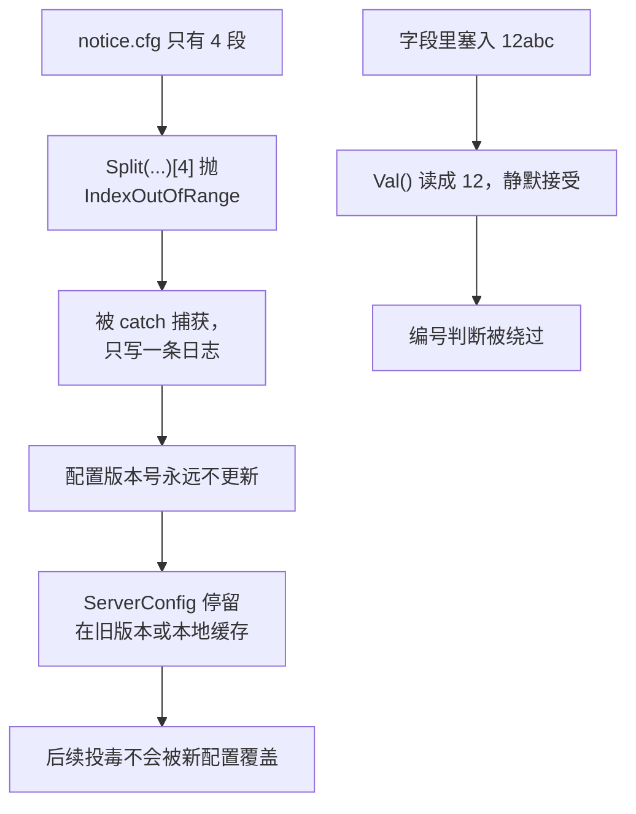

**复核发现**：✅ 成立，且字段实际有 4 个（`[3]` 用于 `download.json` 的编号）。**攻击价值**：不是直接 RCE，而是"让配置更新静默失效"，为长期投毒提供一个不会被覆盖的窗口。

---

### A-07 ｜ PCL-INFO-002 一句把因果说反了 20 年的提示

- **判定**：✅ 成立（信息级）　**证据**：**C 级**（结论依赖 .NET 行为知识，二进制只能证明文案内容）
- **代码锚点**：`…cs:23708-23714`

> **大白话**：系统**已经开了** FIPS 严格模式，导致某个加密算法被禁用、PCL 报错。PCL 却提示"由于系统**未启用** FIPS……请按照教程**启用**该功能"。用户照着做完，问题往往更严重。

**代码实锤**

```csharp
if (ex8 is InvalidOperationException && ex8.Message.Contains("FIPS"))
{
    if (ModMain.MyMsgBox("由于系统未启用 FIPS 兼容算法，PCL 可能无法正常运行。\r\n请按照教程启用该功能，然后重启 PCL。",
                         "兼容性警告", "打开教程", "取消", "", IsWarn: true) == 1)
        ModBase.OpenWebsite("https://blog.csdn.net/qq_37608398/article/details/81209922");
}
```

**为什么是 C 级**：代码只能证明"文案这么写"和"异常文本包含 FIPS"。至于 .NET 在**什么条件下**抛这句话（`This implementation is not part of the Windows Platform FIPS validated cryptographic algorithms`），需要 .NET 运行时的知识——它出现在"注册表已开启 FIPS 策略、而调用的算法不在白名单"时。因此文案的因果是反的。

**利用流程（这里没有攻击者，是一条"帮倒忙"的路径）**

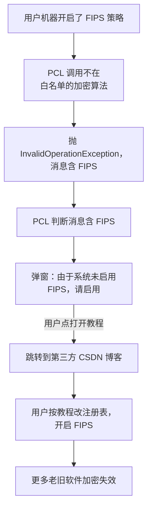

**复核发现**：✅ 成立，但必须标注 C 级。另外两点：① 提示把用户导向**第三方博客**（内容不可控），这是可用性/供应链上的小瑕疵；② `OpenWebsite` 有协议白名单，不存在 `file://` 复用风险（已核对 `…cs:88219` 附近）。

---

### A-08 ｜ PCL-RCE-002 `setup` 能改设置——但不是"任意改"

- **判定**：⚠️ 部分成立（结论方向对，机制错了）　**证据**：A 级
- **代码锚点**：`…cs:71725-71756`（`Set`）、`71343-71362`（构造函数）、`71758-71770`（`SetSafe`）

> **大白话**：很容易以为"能往设置里写任意键、任意类型"。其实不是——PCL 有一本**花名册**，只认识册子上有的设置项，写别的直接报错；类型也会被强制转换。**但真正的问题更隐蔽**：花名册里有几个设置项，本身就是"执行命令"的开关。门禁名单里赫然写着"钥匙保管员"。

**代码实锤：三层防护，全部存在**

```csharp
// ① 花名册（…cs:71728）
if (!Entries.TryGetValue(Key, out value))
    throw new KeyNotFoundException("未找到设置项：" + Key);

// ② 类型强转（…cs:71734）
Value = Conversion.CTypeDynamic(Value, value.Type);

// ③ 只有值真的变了才落盘并触发回调（…cs:71739-71747）
if (!Operators.ConditionalCompareObjectEqual(value.GetCache(Instance), Value, TextCompare: false))
{
    value.Set(Value, Instance);
    value.Save(Instance);
    if (value.OnChanged != null) value.OnChanged(Value);
}
```

**但花名册里有这些东西（…cs:71461-71566）**

```csharp
new Setting("SystemSystemCache",  "",        Sources.Registry),   // 缓存目录 → 见 B-04
new Setting("LaunchAdvanceJvm",   "-XX:…"),                     // JVM 参数 → 见 B-01
new Setting("LaunchAdvanceGame",  ""),
new Setting("LaunchAdvanceRun",   ""),                          // 启动前命令 → 见 B-01
new Setting("CacheAuthServerServer", "", Sources.Registry, Encrypted: true),  // 认证服务器地址
new Setting("ToolDownloadCert", false, Sources.Registry, Encrypted: false, a0 => …),  // TLS 策略 → 见 B-07
```

**本次复核新增的关键细节：`setup` 走的是 `Set`，不是 `SetSafe`**

```csharp
public static void SetSafe(string Key, object Value, …)
{
    if (value.Encrypted)
        throw new InvalidOperationException("禁止写入加密设置项：" + Key);   // 有这道保护
    Set(Key, Value, Instance);
}
```

`ServerSub` 里调用的是 `Settings.Set(item4.Key, …)`（`…cs:23866`）——**没有走 `SetSafe`**。这意味着：连标记为 `Encrypted: true` 的 `CacheAuthServerServer`（第三方认证服务器地址）、`LoginAuthPass`（密码）都能被远程写入。写进去的值会被 `DesEncrypt` 加密保存，但读的时候照样解密使用——**加密在这里完全没起到防护作用**。

**利用流程**

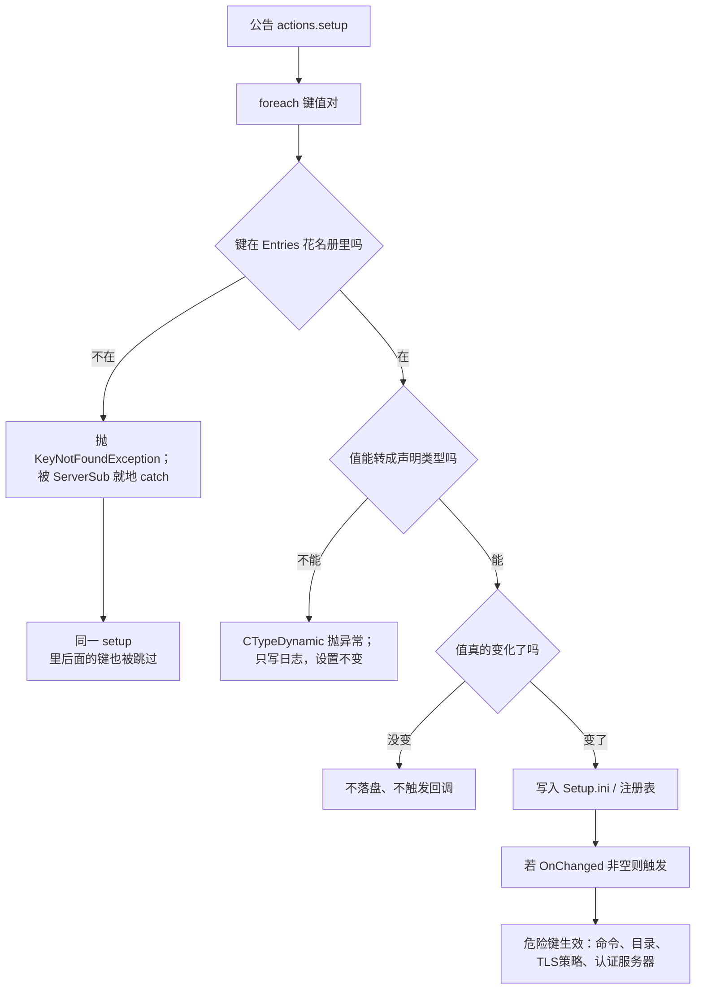

**复核发现**：⚠️ 部分成立，但有三处边界要说清楚：

1. "任意键"不成立（有花名册）；"任意类型"不成立（有强转）；"实例级设置"不成立（`Instance=null` 时 `Source==Instance` 会在 `GetCache` 处抛 NRE，被吞掉）。
2. **真正的问题是"花名册里有权能型设置"**：`LaunchAdvanceRun`、`LaunchAdvanceJvm`、`SystemSystemCache`、`ToolDownloadCert` 都是合法键名，`setup` 写它们不会触发任何异常。
3. **`SetSafe` 的存在是更重的证据**：作者**知道**加密项不该被程序化写入，专门写了这个函数，但 `setup` 调的是 `Set`。这是"有防护、没接线"的第二个例子（第一个是 `FileChecker`）。

---

### A-09 ｜ PCL-PARSE-002 一个字段类型写错，整条公告链就断了

- **判定**：⚠️ 部分成立（结论对，失效表现要说清）　**证据**：A 级
- **代码锚点**：`…cs:23807-23808`、`23903-23910`

> **大白话**：公告里的 `importantLevel` 本该是数字。如果被写成 `"abc"`，转换会抛异常，而这个异常**不在单条公告的 `try` 里**，在**整个循环外面**——于是一条坏公告能让**后面所有公告都不执行**，还会顺手删掉本地公告缓存。

**代码实锤**

```csharp
// 转换点（…cs:23807）
int num8 = (int)(val["importantLevel"] ?? JToken.op_Implicit(2));
bool flag2 = (bool)(val["isUpdate"] ?? JToken.op_Implicit(false));
```

`(int)JToken` 遇到 `"abc"` 会抛 `FormatException` / `InvalidCastException`。它所在的位置是**公告循环内部、但外层 `try` 的覆盖范围内**：

```csharp
// 外层 catch（…cs:23903-23910）
catch (Exception ex17)
{
    Logger.Warn(text5, ...);                       // 把远端原文写进日志
    Logger.Error(ex18, $"读取 PCL 服务器公告失败（{text5.Length}）", ...);
    FileUtils.Delete(ModBase.PathTemp + "Cache\\Notice.json", false);   // 删本地缓存
}
```

**利用流程**

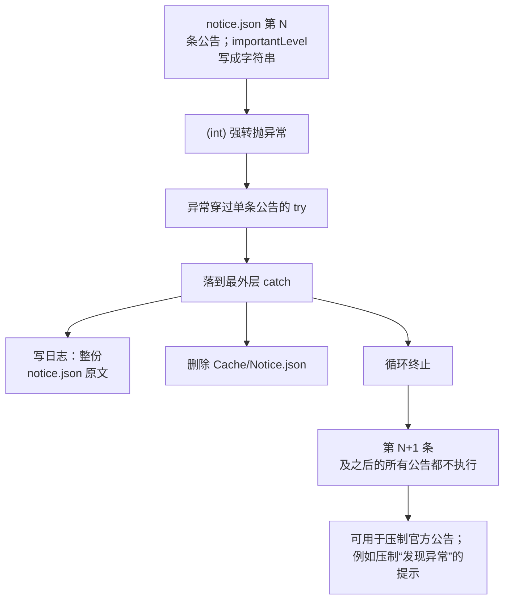

**复核发现**：⚠️ 部分成立。真实行为是**整条链中断**，而不是"逐条跳过"：`switch` 的 `default` 分支 `Logger.Warn` 后 `continue`，后续 `actions` 一项都不再处理。这个区别很重要——攻击者用一条畸形公告就能"关掉公告系统"，成本极低。另外 `setup` 的类型污染假设不成立（见 A-08）。

---

### A-10 ｜ PCL-FILE-001 固定路径写入——有风险，但没有"任意写"

- **判定**：⚠️ 部分成立（降级为低危）　**证据**：A 级
- **代码锚点**：`…cs:23641`、`23482-23500`（`UpdateReplace`）、`img_25aa0b:3996-4050`（解压）

> **大白话**：PCL 会把远端内容写到"固定文件名 + 固定目录"。通常担心的两件事——ZIP 里放 `..\..\` 写到任意位置（路径穿越）、`--update` 指定任意路径——**都被代码否掉了**，但"固定路径可预测"这一条成立。

**代码实锤：两道防护都在**

```csharp
// ① ZIP 逐项校验（MeloongCore …:4047）
if (!PathUtils.IsParentOf(outputDirectory, text2))
    throw new InvalidDataException("Zip 文件项 " + entry.FullName + " 的路径在压缩包之外…");

// ② IsParentOf 先用 GetFullPath 规范化（…:4523-4560）
public static string ForCompare(string pathName)
    => RemoveSlashSuffix(RemoveExtendedPrefix(Path.GetFullPath(pathName)).Replace("/", "\\"));

// ③ --update 只取文件名，并锚定启动器目录（…cs:23482-23492）
string text = Paths.Base.Substring(0, Paths.Base.Length - 4) + PathUtils.GetLastPart(OldFileName);
```

`Path.GetFullPath` 会把 `..` 折叠掉，所以 `a\..\..\b` 这类写法无法逃出父目录。

**利用流程（这条流程的关键是"断在哪里"）**

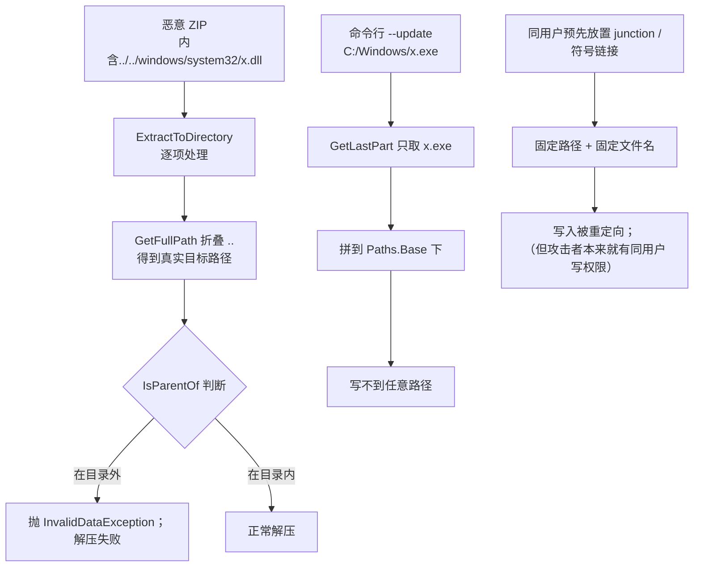

**复核发现**：⚠️ 部分成立，定为低危。两条否定结论成立。**但"固定路径可预测"与 B-04（目录可控）组合后危害上升**：攻击者不需要穿越，只需要把**目录**换掉。

---

### A-11 ｜ PCL-INFO-003 "最新正式版"可以被远程塞进来

- **判定**：⚠️ 部分成立（机制已被供应链路径取代）　**证据**：A 级
- **代码锚点**：`…cs:23596-23603`（下载）、`23685-23691`（自复制）

> **大白话**：PCL 会把"当前自己"复制成 `Latest.exe`，当作"最新正式版"缓存。固化污染版本的风险确实存在。另外还有一条更直接的路：**直接从服务器下 `Latest.zip` 解压出 exe**，只验"大于 1MB"。

**代码实锤**

```csharp
// ① 自复制（…cs:23685-23691）
if (Settings.Get<int>("SystemHighestSavedBetaVersionReg") < 406 || !FileUtils.Exists(PathTemp + "Latest.exe"))
{
    Settings.Set("SystemHighestSavedBetaVersionReg", 406);
    FileUtils.Copy(ModBase.PathExe, PathTemp + "Latest.exe");
}

// ② 从服务器下载（…cs:23596-23601）
NetDownloadByLoader(ServerConfig["Update"]["Release"]["DownloadUrls"], PathTemp + "Latest.zip",
                    LoaderToSyncProgress, new FileChecker { MinSize = 1048576L });
FileUtils.ExtractToDirectory(PathTemp + "Latest.zip", PathTemp, null);
FileUtils.Move(PathTemp + "Plain Craft Launcher 2.exe", PathTemp + "Latest.exe");
```

**利用流程**

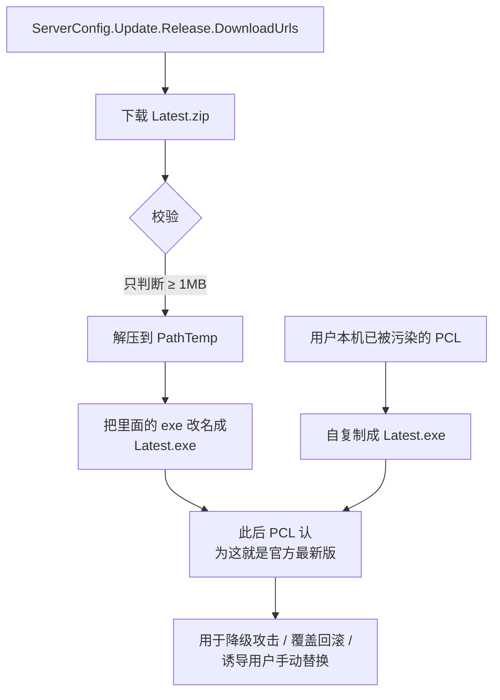

**复核发现**：⚠️ 成立。单独看是"信息级"，但它是**整条供应链的最后一公里**：攻击者已经能改 `DownloadUrls` 时，`Latest.zip` 只是多一个落点。真正的危害在 A-02。

---

### A-12 ｜ PCL-INFO-001 设备指纹外发 —— ❌ 不成立

- **判定**：❌ **不成立**　**证据**：A 级（反证）
- **代码锚点**：`…cs:23786`（唯一替换点）、`22913-22937`（签名函数）、全文 `?id=` 计数 = **0**

> **大白话**：有一种常见的猜测是"PCL 会把设备识别码拼在网址后面发给服务器"。实际上完全没有。PCL 的请求只多一个 `sign` 参数，那是**防盗链签名**，跟你的设备无关。而"识别码"确实出现在公告里——但方向是**服务器发下来、客户端本地替换**，一个字节都没往上传。

**代码实锤：三条反证**

```csharp
// 反证 ①：全文件搜索 ?id= 与 &id= —— 0 处
// 反证 ②：唯一被追加的参数是 sign（…cs:22913-22937）
string text5 = ComputeHash(Join(new[]{ path, ts, rand, "0", "PCL2Server" }, "-"), HashMethod.Md5);
return text + (text.Contains("?") ? "&" : "?") + "sign=" + Join(new[]{ ts, rand, "0", text5 }, "-");

// 反证 ③：识别码只用于"下行模板填充"（…cs:23786）
foreach (JObject item in DeserializeJson(text5.Replace("{UNIQUE}", ModBase.Identify)))
```

注意 ③ 的方向：`text5` 是**服务器下发的公告文本**，`Replace` 把里面的 `{UNIQUE}` 换成本地识别码，然后**在本地解析**。数据流是**服务器 → 客户端**。

**数据流图（这张图的作用是"证明没有一条线通到网络"）**

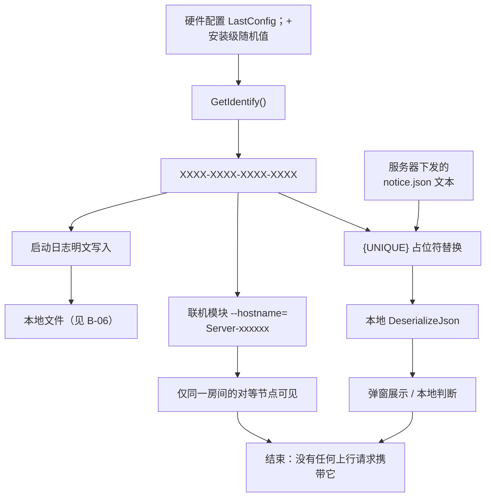

**复核发现**：❌ 不成立。两个衍生结论（跨会话追踪、传输截获）随之不成立。**但**"不外发"不等于"不泄露"——它进了日志、还当成了加密密钥（见 B-06）。这一条是本项目最典型的"**用行业惯例代替事实**"的错误：把它当假设没问题，把假设写进结论就有问题了。

---

### A-13 ｜ PCL-MITM-001 TLS 校验可能被禁用 —— ❌ 不成立

- **判定**：❌ **不成立**　**证据**：A 级 + 运行时实验
- **代码锚点**：`…cs:52547-52556`（客户端构造）、`52671-52677`（IP 改写）、`52849-52868`（唯一的回调）

> **大白话**：有一种常见的猜测是"开发者写了 `return true` 无条件信任任何证书"。实际上没有。唯一的"放宽"回调默认**根本没被安装**。而且"把网址改成 IP 会导致证书校验失效"这个技术直觉，**我用同款运行时实测否定了**。

**代码实锤**

```csharp
// ① 主客户端：没有任何自定义校验回调（…cs:52547）
RequestClient = ClientExtensions.CreateClient(
    new FileStore(ModBase.PathTemp + "Cache/Http/"),
    new HttpClientHandler { AutomaticDecompression = GZip|Deflate, UseCookies = false });

// ② IP 改写：URI 换成 IP，Host 头保留域名（…cs:52585 附近）
Request.Headers.Host = Request.RequestUri.Authority;
Request.RequestUri = new UriBuilder(Request.RequestUri) { Host = iPAddress.ToString() }.Uri;

// ③ 唯一放宽回调：只在设置变更时安装（…cs:52849），默认不装
```

**本次实测（.NET Framework 4.8，与 PCL 同运行时）**

| 用例 | 结果 |
|---|---|
| `https://104.20.23.154/` + `Host: example.com` | **200 OK** —— 证书按 Host 头校验，通过 |
| `https://104.20.23.154/` + `Host: wrong-name.example` | **失败**：`未能创建 SSL/TLS 安全通道` |
| 自签证书 + `https://127.0.0.1:8443/` + `Host: api.minecraftservices.com` | 回调触发，`Address.Host = 127.0.0.1`，`Contains("minecraftservices") = False` |

第二条最关键：**反向用例证明校验确实在工作**。如果 PCL 真的无条件信任证书，第二条也应该成功。

**流程（把"猜想"和"事实"并排）**

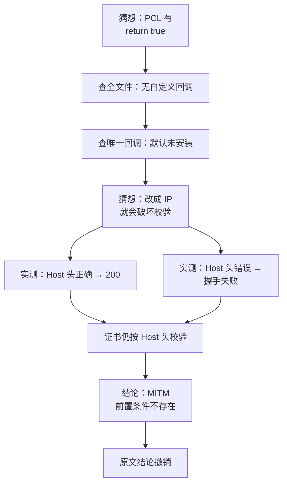

**复核发现**：❌ 不成立。方法论上值得记一笔：这条假设**被标注为**假设，但在后文又被当成既成事实使用（"属未缓解的高危前置条件"）。这是安全评估里最常见的滑移，也是最容易骗过读者的一步。

---

### A-14 ｜ PCL-CHAIN-001 `{CDN}` 被 setup 重定向 —— ❌ 不成立

- **判定**：❌ **不成立**　**证据**：A 级（反证）
- **代码锚点**：`…cs:22913-22937`

> **大白话**：`{CDN}` 这个名字太像"CDN 地址"了，于是被猜成"域名占位符"。实际它是"**防盗链签名占位符**"——替换结果只是往网址后面加一个 `?sign=时间戳-随机数-0-MD5`，**主机名一个字母都不会变**，而且这个函数根本不读任何设置。

**代码实锤**

```csharp
internal static string SecretCdnSign(string UrlWithMark)
{
    if (ModBase.ApplicationStartTick < 1) return UrlWithMark;
    if (!EndsWithF(UrlWithMark, "{CDN}", false)) return UrlWithMark;

    string text  = UrlWithMark.Replace("{CDN}", "").Replace(" ", "%20");   // 只删占位符
    string rand  = EnsureLength(RandomInteger(0, 2147483645).ToString("x"), '0', 8);
    string ts    = GetUnixTimestampUtc().ToString();
    string path  = /* "://" 之后第一个 "/" 起的部分 */;
    string sign  = ComputeHash(Join(new[]{ path, ts, rand, "0", "PCL2Server" }, "-"), HashMethod.Md5);
    return text + (text.Contains("?") ? "&" : "?") + "sign=" + Join(new[]{ ts, rand, "0", sign }, "-");
}
```

关键点：**函数体里没有 `Settings.Get`**。它只依赖启动时刻、随机数、时间戳。

**输入输出对照**

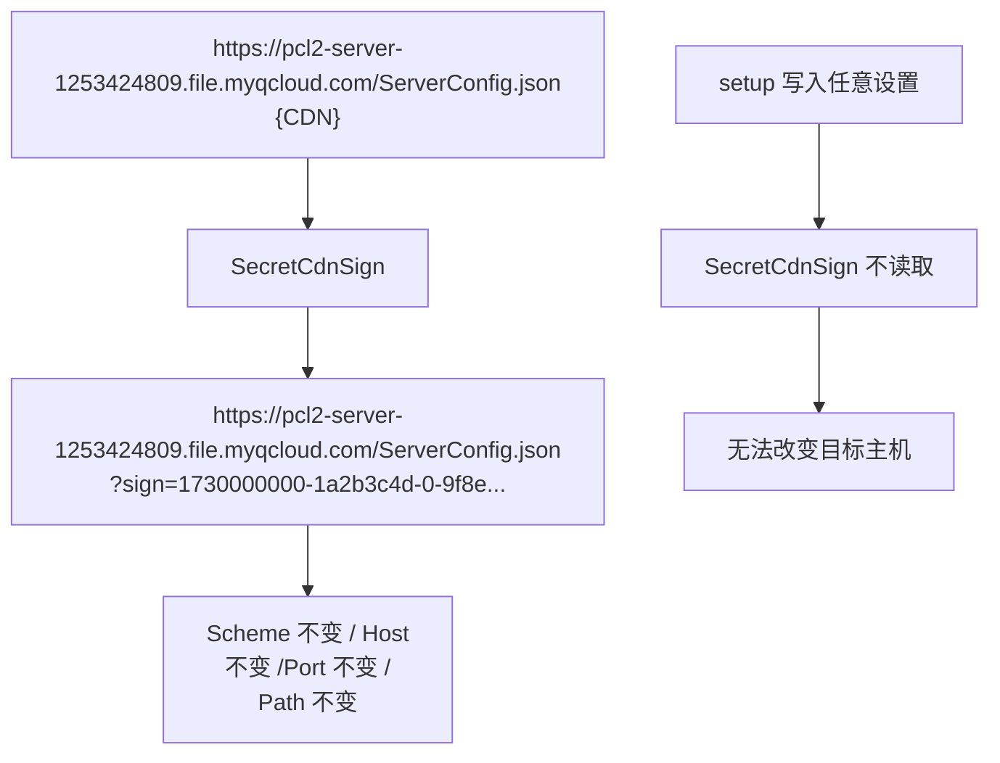

**复核发现**：❌ 不成立。**但有一个残留的独立弱点**（作为观察项保留）：签名密钥 `PCL2Server` 硬编码在二进制里，摘要用 MD5，且签名只覆盖 `path` 不含 `host`。后果是**可以伪造合法 URL 盗刷 CDN 流量**，但不能改变请求目标。这不是 RCE，未单列。

---

### A-15 ｜ PCL-HARD-001 所有鸡蛋放在一个桶里

- **判定**：🔽 成立，但性质是"设计风险"不是"可利用漏洞"　**证据**：A 级
- **代码锚点**：`…cs:23671`、`23730`、`23746`、`23769`

> **大白话**：公告、配置、特供版清单，全部来自同一个域名、同一个对象存储桶。桶一旦被写，**全量用户同时中招**；没有备用源、没有分权、没法轮换。

**代码实锤**

```csharp
"https://pcl2-server-1253424809.file.myqcloud.com/notice.cfg{CDN}"
"https://pcl2-server-1253424809.file.myqcloud.com/ServerConfig.json{CDN}"
"https://pcl2-server-1253424809.file.myqcloud.com/notice.json{CDN}"
"https://pcl2-server-1253424809.file.myqcloud.com/minecraft/download.json{CDN}"
```

**风险传导图**

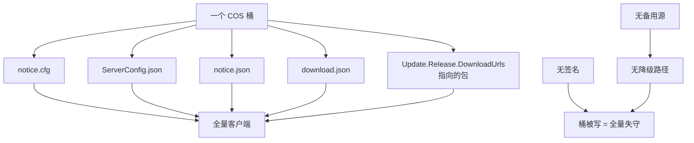

**复核发现**：🔽 成立（设计风险）。它本身不是"漏洞"，是"爆炸半径"。但要注意：**它把所有其他漏洞的利用门槛统一降到了"一个桶"**。作者的说明里提到"各文件权限相同、统一操作"——这恰恰意味着单点失陷即全量失陷。

---

### A-16 ｜ PCL-LOG-001 日志里抄了一份服务器原文

- **判定**：🔽 成立（泄露内容为公告原文与服务器路径）　**证据**：A 级
- **代码锚点**：`…cs:23680`（`notice.cfg`）、`23778`（`notice.json`）、`23786`（替换点）

> **大白话**：PCL 会把从服务器拿到的公告原文写进日志。容易担心"`{UNIQUE}` 已经被替换成真实识别码"——**并没有**：日志记录的是替换**之前**的字符串。真正严重的泄露在别处（识别码 + 环境信息，见 B-06）。

**代码实锤（顺序很重要）**

```csharp
Logger.Info($"本地公告编号：{num2}，服务器公告：{text3}，需更新", ...);   // ① notice.cfg 原文
...
Logger.Warn(text5, ...);                                                // ② notice.json 原文
...
foreach (JObject item in DeserializeJson(text5.Replace("{UNIQUE}", ModBase.Identify)))  // ③ 才替换
```

②在③之前，所以落盘的是**未替换**的文本。

**数据流**

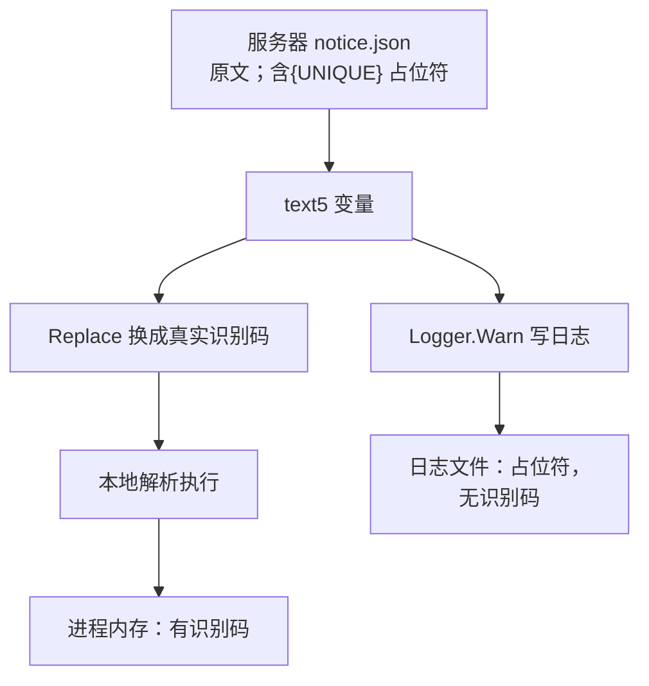

**复核发现**：🔽 低危。实际泄露的是"服务器内部结构 + 公告原文"，而不是识别码；真正的识别码泄露在 B-06（它是被本地日志和加密密钥带出去的）。

---

## 四、B 组逐条复核（本次反汇编新增 8 条）

### B-01 ｜ PCL2-2026-01 改一个字符串，就能在你下次开游戏时执行命令

- **判定**：✅ 成立（**本报告中最危险的一条**）　**证据**：A 级
- **严重程度**：🔴 高危
- **代码锚点**：`…cs:71537`（设置定义）、`58402-58451`（执行点）、`58416-58417`（导出 bat）

> **大白话**：PCL 有一个"高级用户"功能：启动游戏前先执行一条自定义命令。这个设置项的名字叫 `LaunchAdvanceRun`。问题是，**同一本"设置花名册"也被服务器下发的 `setup` 动作使用**。于是"给高级玩家用的功能"变成了"攻击者的远程命令入口"——写一次，永久生效，下次开游戏就执行。

**代码实锤（三段式数据流，缺一不可）**

```csharp
// ① 设置定义：普通设置项，注册在全局花名册里（…cs:71537）
new Setting("LaunchAdvanceRun", "");

// ② 远程写入：setup 走 Settings.Set（…cs:23866）
Settings.Set(item4.Key, item4.Value.ToString());

// ③ 启动游戏时执行（…cs:58404-58451）
string text = Settings.Get<string>("LaunchAdvanceRun");
if (text != "") text = ModMain.ArgumentReplace(text);      // 只替换 {xxx} 占位符，无过滤
...
process = ModBase.StartProcess(new ProcessStartInfo
{
    FileName = "cmd.exe",
    Arguments = $"/c \"{text}\"",                            // ← 原样进命令行
    WorkingDirectory = ModMinecraft.McFolderSelected,
    UseShellExecute = false,
    CreateNoWindow = true                                    // ← 连窗口都没有
});
```

**为什么这一条比"替换更新包"更值得重视**

| 对比项 | 改更新包（A-02） | 改 `LaunchAdvanceRun`（本条） |
|---|---|---|
| 需要替换可执行文件吗 | 需要 | **不需要** |
| 需要哈希/签名绕过吗 | 需要（虽然本来就没有） | **不需要** |
| 需要管理员权限吗 | 否 | **否** |
| 何时生效 | 更新后重启 | **下次点"启动游戏"** |
| 会持久化吗 | 是（exe 被替换） | **是（写进 Setup.ini，重装保留配置仍在）** |
| 用户能看到吗 | 更新有提示（非静默时） | **看不到任何东西** |

**利用流程**

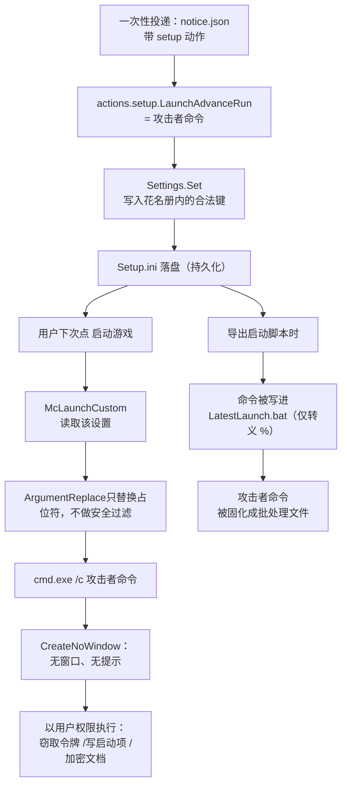

**前置条件**：能投递一次带 `setup` 的公告（这是所有远程链的共同前提）。
**后果**：持久化任意代码执行，用户权限即可，无需管理员。

**复核发现**：✅ 成立。两条设置项的能力需要分开评估。

Java **不支持** `-javaagent:http://...` 这种远程 URL（agent 必须是本地文件），所以 `LaunchAdvanceJvm` 实际需要 `-javaagent:C:\已有路径\evil.jar`——也就是说**必须先有一个恶意文件落到本地**（可以配合 B-04 的目录可控来实现）。

因此两者的定位是：

| 设置项 | 能力 | 是否需要本地文件 | 危害 |
|---|---|---|---|
| `LaunchAdvanceRun` | 任意 shell 命令 | **不需要** | 🔴 直接 RCE |
| `LaunchAdvanceJvm` | 追加 JVM 参数（`-javaagent` / `-cp` / `@argfile`） | **需要** | 🟠 二阶段执行（前提是已有文件落地能力） |

两者不在同一量级：`LaunchAdvanceRun` 一步到 RCE，`LaunchAdvanceJvm` 需要配合一个文件落地步骤。但结论一致：**这两类设置都不该出现在远程可写名单里**，修复排序上先处理 `LaunchAdvanceRun`。

---

### B-02 ｜ PCL2-2026-02 服务器给的参数字符串，直接塞进子进程命令行

- **判定**：✅ 成立　**证据**：A 级
- **严重程度**：🔴 高危
- **代码锚点**：`…cs:38270-38294`、`38567-38580`、`38211-38214`

> **大白话**：PCL 启动"联机模块"（EasyTier）时，命令行参数是这么来的：先取服务器配置里的一段字符串，然后在后面接上自己生成的参数，整串直接交给子进程。攻击者写的那段字符串**排在第一位**，所以连"第一个参数"都是他说了算。

**代码实锤**

```csharp
// ① 从服务器配置里原样取出（…cs:38270）
string text3 = (string)ModSecret.ServerConfig["Link"]["Argument"];
text3 += $" --network-name={NetworkName} --network-secret={NetworkSecret} --listeners {num} --rpc-portal {RPCPort} --private-mode true";
...
foreach (string item in list) text3 += $" -p=\"{item}\"";      // ② 节点列表也未转义
ProcessStart(text3);

// ③ 整串交给子进程，并明文写日志（…cs:38571-38580）
FileName = PathEasyTier + "联机模块.exe",
Arguments = Arguments,
UseShellExecute = false,
CreateNoWindow = true,
...
Logger.Info($"正在启动 EasyTier：{Arguments}", ...);            // 含 --network-secret
```

**两个独立的注入点**

1. `Link.Argument`：整个字符串是**第一个 token**，攻击者可改变 EasyTier 的运行模式（如加 `--config` 指向自己的配置、加对等节点、改转发规则）。
2. `Peers` 列表：`-p="{item}"` 只是把值**用引号包起来**，如果 `item` 里本身含 `"`，就能闭合引号并追加任意参数。这一点很容易被漏掉。

**为什么 `UseShellExecute = false` 不够**

它只挡住了 shell 元字符（`&`、`|`、`>` 不会被执行），**完全挡不住参数级注入**——参数仍然按空格切分后传给目标程序，攻击者塞进去的每个 `--xxx` 都会被 EasyTier 当成合法参数。

**利用流程**

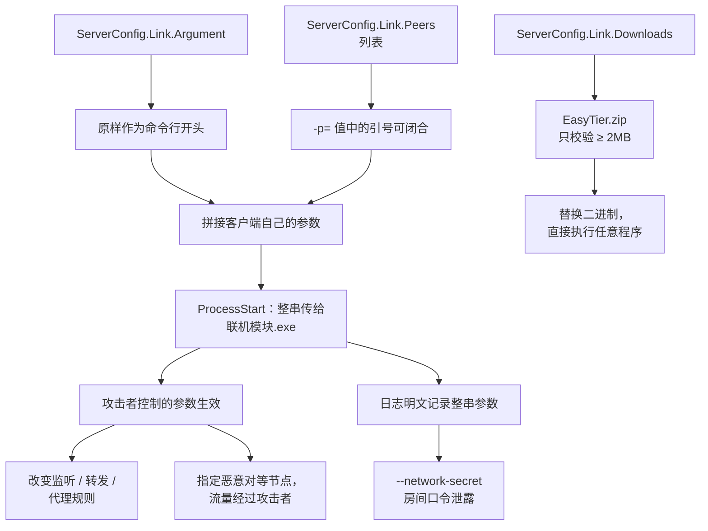

**前置条件**：能改写 `ServerConfig.Link`。
**后果**：联机流量劫持、内网暴露面扩大、房间口令泄露；配合 `Downloads` 可升级为任意代码执行。

**复核发现**：✅ 成立。注入位置比"追加参数"更彻底：`Argument` **本身就是第 0 个 token**，攻击者控制的是命令的**开头**（可以先用 `--xxx` 顶掉 PCL 自带的参数，也可以直接塞一个可执行路径）。第二个注入点是节点列表的 `-p="{item}"`——引号内没有转义，`"` 即可闭合。

---

### B-03 ｜ PCL2-2026-03 "静默更新"这道门，是画在墙上的

- **判定**：✅ 成立　**证据**：A 级
- **严重程度**：🔴 高危
- **代码锚点**：`…cs:22887`、`24068-24075`、`23875-23886`

> **大白话**：设计意图是"静默更新需要额外授权"。实现上，这个授权判断是个常量 `true`；而"输入授权码"的界面根本不存在，只弹一句提示。所以"静默更新"和"普通更新"在正式版里**完全一样**：服务器说更新就更新，用户零确认。

**代码实锤**

```csharp
private static bool HasUpdatePermission => true;          // 常量，编译期就定了

public static void InputPotatoCode(bool IsUpdating)        // 所谓的"权限门"
{
    ModMain.Hint("请使用 PCL 快照版输入土豆码！…");         // 只有提示，没有输入框
}
internal static void GeneratePotatoCode() { }              // 空实现
```

于是 `ServerSub` 里这段判断永远进不去：

```csharp
if (!HasUpdatePermission)      // 永远 false
{
    if (!flag3) InputPotatoCode(IsUpdating: true);
    if (!HasUpdatePermission) break;
}
UpdateStart(flag3);            // 直接到这里
```

**利用流程**

```mermaid
flowchart TD;
    A["公告 actions:<br/>slientupdate"] --> B{"HasUpdatePermission"};
    B -->|常量 true| C["UpdateStart(Silent<br/>= true)"];
    C --> D["不显示进度条、不进任务栏"];
    D --> E["下载更新包（无<br/>FileChecker）"];
    E --> F["删除 exe → 解压覆盖"];
    F --> G["IsUpdateWaitingRestart<br/>= true"];
    G --> H["用户下次退出/<br/>重启时换成新 exe"];
    H --> I["全程零确认、零提示"];
```

**复核发现**：✅ 成立。补充一个容易忽略的行为差异：静默更新**不会立刻重启**，而是设 `IsUpdateWaitingRestart = true`（`…cs:22707-22711`），等用户自己退出时才替换。这让它更隐蔽——用户不会看到"正在重启"的画面。

---

### B-04 ｜ PCL2-2026-04 缓存目录可以被远程改到任何地方

- **判定**：✅ 成立　**证据**：A 级
- **严重程度**：🟠 中危（与 A-01 组合后可升为高危）
- **代码锚点**：`…cs:71461`（设置）、`87555`（`PathTemp`）

> **大白话**：PCL 把所有临时文件、缓存、下载的更新包都放在 `PathTemp` 下。而 `PathTemp` 的取值来自一个设置项 `SystemSystemCache`，这个设置项在花名册里，`setup` 能改。于是攻击者可以指定"把恶意文件放到哪个目录"。

**代码实锤**

```csharp
// …cs:71461
new Setting("SystemSystemCache", "", Sources.Registry);

// …cs:87555 —— 静态字段，类型初始化时算一次
public static string PathTemp =
    (Settings.Get<string>("SystemSystemCache") == ""
        ? System.IO.Path.GetTempPath() + "PCL\\"
        : Settings.Get<string>("SystemSystemCache"))
    .Replace("/", "\\").TrimEnd('\\') + "\\";
```

**它管着哪些文件**（全部在 `PathTemp` 之下）

| 文件 | 用途 |
|---|---|
| `Cache\ServerConfig.json` | 服务器配置（**会被优先读取**） |
| `Cache\Notice.json` | 公告缓存（**会被优先读取**） |
| `Cache\Notice.cfg` | 公告编号 |
| `Cache\Http\*` | HTTP 响应缓存 |
| `Latest.zip` / `Latest.exe` | "最新正式版" |
| `EasyTier.zip` / `联机模块.exe` | 联机模块 |

**利用流程（基础形态）**

```mermaid
flowchart TD;
    A["setup:<br/>SystemSystemCache =<br/>攻击者指定目录"] --> B["写入 Setup.ini"];
    B --> C["下次启动，PathTemp<br/>指向该目录"];
    C --> D["更新包 / Latest.exe /<br/>联机模块 落到该目录"];
    D --> E["文件名固定，<br/>内容服务器可控"];
    E --> F["投放到桌面 / 启动目录 /<br/>被其它程序扫描的目录"];
    F --> G["提升社工成功率"];
    C --> H["若设为 UNC 路径 //<br/>host/share"];
    H --> I["从该共享读配置、写文件"];
    I --> J["触发 NTLM 认证外发"];
```

**本次复核新增的强化链（重要）**

`ServerSub` 读取公告时有一个"缓存优先"分支：

```csharp
// …cs:23763
if (num4 <= num2 && FileUtils.Exists(ModBase.PathTemp + "Cache\\Notice.json"))
    text5 = FileUtils.ReadAsString(ModBase.PathTemp + "Cache\\Notice.json", ...);   // 读本地缓存
else
    text5 = NetRequestByClientRetry("...notice.json{CDN}", ...);                     // 才联网
```

其中 `num2 = Settings.Get<int>("HintNotice")`（`…cs:23663`），而 `HintNotice` 同样在花名册里（`…cs:71430`）。

于是形成一条**不需要持续控制 CDN** 的维持链：

```mermaid
flowchart TD;
    A["第一次成功投递 setup"] --> B["SystemSystemCache =<br/>\\attacker\share"];
    A --> C["HintNotice = 999999"];
    B --> D["下次启动 PathTemp<br/>指向攻击者共享"];
    C --> E["num4 <= num2 恒成立"];
    D --> F["读取 \\attacker\shareCache/Notice.json"];
    E --> F;
    F --> G["公告动作被执行"];
    G --> H["攻击者不再需要碰官方 CDN"];
    H --> I["即使官方修复了 CDN，<br/>投毒仍持续"];
```

**这条链的意义**：它把"一次性入口"变成了"**长期据点**"。官方即使更换 CDN 密钥、清理桶内容，只要 `Setup.ini` 里那两个值还在，投毒就继续生效。

**复核发现**：✅ 成立，且**危害比单看"目录可控"更大**（上述组合）。另外确认：`PathTemp` 是静态字段，改设置后**需要重启**才生效——这一点让攻击者必须等下一次启动，但也让行为更隐蔽。

---

### B-05 ｜ PCL2-2026-05 一个能用的 API Key，藏在 Base64 里

- **判定**：✅ 成立　**证据**：A 级
- **严重程度**：🟠 中危
- **代码锚点**：`…cs:22955-22960`

> **大白话**：PCL 访问 CurseForge 时带一个 `x-api-key`。这个 Key 被 Base64 编码后写死在 exe 里——Base64 **不是加密**，一行命令就能还原。而且判断是否要带这个头的逻辑是"网址里包含某段文字"，于是攻击者的域名只要长得像，也能收到这把钥匙。

**代码实锤**

```csharp
if (Url.Contains("api.curseforge.com") || Url.Contains("forgecdn.net"))
{
    Req.Headers.Add("x-api-key", Encoding.Default.GetString(Convert.FromBase64String(
        "JDJhJDEwJDdXV1YxV0VMY3dYOFhwN2Q2OE1Icy41Z3JUeVpWYTZTeW55ZVN5TWgxcnNFODluSWEwOXpP")));
}
```

`Convert.FromBase64String` 之后是 `$2a$10$7WWV1WEL…` 形态的字符串，**直接就是可用凭据**（不是校验哈希）。

**利用流程**

```mermaid
flowchart TD;
    A["拿到 exe"] --> B["一行命令 Base64 解码"];
    B --> C["得到 x-api-key"];
    C --> D["自建客户端冒用"];
    D --> E["配额耗尽 / 按 Key 计费 /<br/>平台封禁"];
    E --> F["全体用户的 Mod<br/>下载同时失效"];
    G["构造 URL:<br/>https://api.curseforge.com.attacker.tld/..."] --> H["Url.Contains 命中"];
    H --> I["PCL 把 Key<br/>发给攻击者服务器"];
    I --> C;
```

**复核发现**：✅ 成立。`Contains` 是子串匹配，`api.curseforge.com.evil.tld` 会命中。需要补充的是：**触发这个分支要求攻击者能影响下载 URL 的来源**（例如整合包内的下载地址），不是任意页面都能触发——这限制了它的现实可达性。

---

### B-06 ｜ PCL2-2026-06 用一把公开的钥匙锁保险箱

- **判定**：✅ 成立　**证据**：A 级
- **严重程度**：🟠 中危
- **代码锚点**：`…cs:71717`（IV）、`71966-71977`（DES）、`71393`（密钥来源）、`78406`（日志）

> **大白话**：微软账号令牌、第三方认证密码，PCL 用 DES 加密后存起来。DES 本身已经过时（56 位密钥）；更糟的是**密钥完全可推导**——密钥 = `"PCL" + 识别码` 的哈希；而识别码**每次启动都明文写进日志**。等于把钥匙和保险箱放在同一个抽屉里。

**代码实锤**

```csharp
// ① 固定 IV（…cs:71717）
private static readonly byte[] desInitialVector = Encoding.UTF8.GetBytes("95168702");

// ② DES-CBC，密钥由传入字符串的哈希派生（…cs:71966-71977）
private static string DesEncrypt(string sourceString, string key = null)
{
    key = (key == null) ? "@;$ Abv2"                                       // 硬编码默认密钥
                        : EnsureLength(GetStableHashCode(key).ToString(), 'X', 8).Substring(0, 8);
    ...
    dESCryptoServiceProvider.CreateEncryptor(Encoding.UTF8.GetBytes(key), desInitialVector);
}

// ③ 调用点：密钥材料 = "PCL" + 识别码（…cs:71393）
text = DesEncrypt(text, "PCL" + ModBase.Identify);

// ④ 识别码明文写日志（…cs:78406）
Logger.Info($"识别码：{ModBase.Identify}", ...);
```

被加密的资产（`…cs:71471-71506`）：

```csharp
new Setting("CacheMsAccess",  "", Sources.Registry, Encrypted: true),   // 微软 AccessToken
new Setting("CacheNidePass",  "", Sources.Registry, Encrypted: true),   // 第三方认证密码
new Setting("CacheAuthPass",  "", Sources.Registry, Encrypted: true),
new Setting("LoginNidePass",  "", Sources.Registry, Encrypted: true),
new Setting("LoginAuthPass",  "", Sources.Registry, Encrypted: true),
```

**利用流程**

```mermaid
flowchart TD;
    A["用户上传日志求助"] --> B["日志里明文的识别码"];
    C["读取 Setup.ini / 注册表"] --> D["拿到 CacheMsAccess<br/>等密文"];
    B --> E["密钥 =<br/>GetStableHashCode('PCL'<br/>+ 识别码) 取 8 位"];
    D --> E;
    E --> F["固定 IV 95168702，<br/>DES-CBC 解密"];
    F --> G["微软 AccessToken /<br/>认证密码明文"];
    G --> H["接管 Minecraft 账号"];
    G --> I["密码复用 →<br/>扩散到其它服务"];
```

**复核发现**：✅ 成立。三点补充：

1. **默认密钥 `"@;$ Abv2"` 是全局共享的**——任何忘记传 key 的调用点，其数据在所有 PCL 用户之间用同一把钥匙加密。
2. **固定 IV 让密文可比对**：同一密码在两个用户机器上会得到相同密文（同一密钥时），可直接判断"两人是否同密码"。
3. **`Identify` 的构成**是"硬件配置 `LastConfig` + 安装级随机值"的稳定哈希，同机恒定——所以密钥也同机恒定，一次泄露永久有效。

---

### B-07 ｜ PCL2-2026-07 一个名字和功能相反的隐藏开关

- **判定**：✅ 成立，但**可利用范围限于单个域**　**证据**：A 级 + 实测
- **严重程度**：🟡 中低（**仅对 1 个域有效**）
- **代码锚点**：`…cs:71563-71566`（设置）、`52849-52868`（回调）、`52671-52677`（DNS 跳过名单）

> **大白话**：有一个没有界面、没有文档的设置项 `ToolDownloadCert`。它的名字看起来像"下载证书"，直觉上 `true` 才是"放宽"。实际逻辑是 `&& !Enabled`——**`false` 才是放宽**。放宽的效果是：对 `minecraftservices` 域，**接受任何证书**（包括攻击者自签的）。这等于给中间人开了一扇门。

**代码实锤**

```csharp
// ① 设置项：无 UI、无读取点，只注册 OnChanged（…cs:71563）
new Setting("ToolDownloadCert", false, Sources.Registry, Encrypted: false, a0 =>
{
    ModNet.ShouldValidateSslCertificateOnLogin(Conversions.ToBoolean(a0));
});

// ② 回调：只有证书错误时才走到后面的判断（…cs:52849-52868）
ServicePointManager.ServerCertificateValidationCallback = (Sender, Certificate, Chain, Failure) =>
{
    HttpWebRequest req = Sender as HttpWebRequest;
    if (Failure == SslPolicyErrors.None) return true;
    Logger.Warn($"未通过 SSL 证书验证（{Failure}）…");
    if (req == null) return !Enabled;
    return (req.Address.Host.Contains("xboxlive") || req.Address.Host.Contains("minecraftservices")) && !Enabled;
};
```

**还有一个更宽的兜底分支（容易被忽略）**

```csharp
if (req == null) return !Enabled;      // ← Sender 不是 HttpWebRequest 时
```

当 `Enabled = false`（放宽模式）时，这一行等于"**只要拿不到 HTTP 请求对象，就接受任何证书**"。它的本意大概是"没有上下文时尊重设置"，实际效果是"**最不确定的情况反而最宽松**"——这是一个典型的反模式：兜底分支应当**最严格**，不是最宽松。

**为什么需要"两步"才能装上门**

`Setting` 构造函数只保存 `OnChanged`，**不调用**（`…cs:71343-71362`）；`Settings.Set` 只在**值发生变化**时才触发（`…cs:71739`）。默认值是 `false` 且回调未安装，所以要：

1. 写 `true` → 值变了 → 安装回调（此时 `Enabled=true`，仍然严格）；
2. 写 `false` → 值又变了 → 重新安装（此时 `Enabled=false`，放宽）。

`actions` 是数组，可以放两个 `setup`，所以这在一次投递内可完成。

**本次实测：`Address.Host` 到底是什么（决定这条漏洞的真实范围）**

我在本机起了一个自签证书的 HTTPS 服务，用 .NET Framework 4.8 复刻 PCL 的回调逻辑，请求 `https://127.0.0.1:8443/` 并把 `Host` 头设为 `api.minecraftservices.com`（这正是 PCL"IP 直连"后的形态）：

```
[CB] SenderType        = System.Net.HttpWebRequest
[CB] PolicyErrors      = RemoteCertificateNameMismatch, RemoteCertificateChainErrors
[CB] Address           = https://127.0.0.1:8443/
[CB] Address.Host      = 127.0.0.1
[CB] HostHeader        = api.minecraftservices.com
[CB] Contains(minecraftservices) = False
RESULT = OK 200
```

**结论：`Address.Host` 取的是 URI 的主机（IP），不是 `Host` 头。**

而 PCL 的 `DNSLookup` 会对绝大多数域名做"URI 换 IP、Host 头保留域名"的改写：

```csharp
// …cs:52671-52677
if (new string[3] { "mojang.com", "minecraft.net", "minecraftservices.com" }
        .Any(h => ContainsIgnoreCase(host, h)))
    return null;                    // 这三个域跳过改写
```

把两件事拼起来：

| 域名 | 是否被 IP 改写 | 回调里 `Address.Host` | `Contains(...)` | 回调结果（Enabled=false） |
|---|---|---|---|---|
| `*.xboxlive.com` | **会** | IP 地址 | `False` | **拒绝**（等于没放宽） |
| `*.minecraftservices.com` | **不会**（在跳过名单） | 域名 | `True` | **接受任意证书** |

**结论：实际只有 `minecraftservices` 一个域会被放宽。** xboxlive 那条分支因为 IP 改写使 `Address.Host` 变成 IP，`Contains(...)` 恒为 `false`，等于没放宽。

**利用流程**

```mermaid
flowchart TD;
    A["公告 1:<br/>setupToolDownloadCert<br/>= true"] --> B["值变化，<br/>安装回调（严格模式）"];
    B --> C["公告 2:<br/>setupToolDownloadCert<br/>= false"];
    C --> D["再次安装回调，Enabled<br/>= false"];
    D --> E["进程级 TLS 策略被放宽"];
    E --> F{"请求主机在跳过名单里吗"};
    F -->|xboxlive.com| G["被改写为 IP，<br/>Address.Host = IP"];
    G --> H["Contains 为 False，<br/>仍然拒绝"];
    F -->|minecraftservices.com| I["不改写，<br/>Address.Host = 域名"];
    I --> J["接受任意证书"];
    J --> K["中间人出示自签证书即可<br/>通过"];
    K --> L["截获 login_with_xbox<br/>的XSTS / access token"];
    L --> M["接管 Minecraft 账号"];
```

**复核发现**：✅ 成立，但**范围只有一个域**。把它写成"两个微软域全废"会高估覆盖面——`xboxlive` 的请求因为走了 IP 直连，反而被自己的改造意外保护了。危害仍然真实：`api.minecraftservices.com` 正是"用 XSTS 换 Minecraft 令牌"和"查档案"的接口，截获它足以接管账号。

补充一个不确定性（诚实标注）：以上"仅 minecraftservices 生效"是**静态推导 + 局部实测**，未搭建针对真实域名的完整中间人环境验证。若要下定论，需要在受控网络中做一次端到端 MITM 复现。

---

### B-08 ｜ PCL2-2026-08 在旧系统上主动打开 SSL 3.0

- **判定**：✅ 成立　**证据**：A 级
- **严重程度**：🟡 低危
- **代码锚点**：`…cs:78396-78399`

> **大白话**：Windows 8 以前的系统上，PCL 会把 SSL 3.0 加进"允许的加密协议"列表。SSL 3.0 有 POODLE 等已知攻击，现代软件都默认禁用。PCL 是**主动打开**它。

**代码实锤**

```csharp
if (Environment.OSVersion.Version < new Version(6, 2))    // < Windows 8
{
    ServicePointManager.SecurityProtocol =
        SecurityProtocolType.Ssl3 | SecurityProtocolType.Tls |
        SecurityProtocolType.Tls11 | SecurityProtocolType.Tls12;
}
```

**利用流程**

```mermaid
flowchart TD;
    A["目标运行 Windows<br/>7 或更早"] --> B["PCL 启动时启用 Ssl3"];
    B --> C["攻击者已具备中间人位置"];
    C --> D["强制协商 SSL 3.0"];
    D --> E["利用 POODLE 等 CBC<br/>填充预言"];
    E --> F["部分流量被解密"];
```

**复核发现**：✅ 成立。定级低危的理由要说清：**它需要攻击者已经能中间人**，而且服务端通常不会同意协商 SSLv3。它的真正问题是"把已经关掉的门重新打开"，属于加固项而非独立攻击面。

---

## 五、把所有图连起来：一条完整的攻击链

### 5.1 总图

```mermaid
flowchart TD;
    E1["入口 A：<br/>内容分发链路写权限；COS<br/>桶 / 供应链内部"] --> P;
    E2["入口 B：可信证书中间人；<br/>企业代理 / 被控路由 /<br/>公共 WiFi"] --> P;
    E3["入口 C：本机文件写权限；<br/>恶意软件已落地"] --> P;
    P["投递 notice.json +<br/>ServerConfig.json"];

    P --> R1["RCE-001 动作分发；<br/>无签名、无确认"];
    R1 --> S1["setup：改设置"];
    R1 --> S2["update / slientupdate"];
    R1 --> S3["stop：制造中断窗口"];
    R1 --> S4["website / copy：<br/>钓鱼与社工"];

    S1 --> X1["LaunchAdvanceRun；→<br/>cmd.exe /c 任意命令"];
    S1 --> X2["SystemSystemCache<br/>+HintNotice；→ 免 CDN<br/>的长期据点"];
    S1 --> X3["ToolDownloadCert；→<br/>仅minecraftservices<br/>域放宽"];
    S1 --> X4["CacheAuthServerServer；<br/>→登录凭据被导向攻击者"];

    S2 --> X5["替换 PCL 自身 exe"];
    S3 --> X5;

    X1 --> F1["持久化代码执行；<br/>用户权限，无需管理员"];
    X5 --> F1;
    X4 --> F2["账号接管"];
    X3 --> F2;
    X2 --> F1;

    L["B-06 DES 弱加密 +<br/>识别码入日志"] --> F2;
    L --> F1;
```

### 5.2 谁实际能触发什么（现实门槛）

| 攻击者画像 | 能触发 | 难度 |
|---|---|---|
| 拿到 COS 桶写权限 | 全部 24 条中的绝大多数 | 高（需要云账号或供应链内鬼） |
| 能在用户链路上出示可信证书 | 公告/配置投毒 → 除 B-05/B-06 外全部 | 中高（企业代理、被控路由） |
| 只能发一封钓鱼邮件，诱导用户导入证书 | 同上 | 中（社工） |
| 已能在用户机器上写文件 | 全部 | 低（但此时已无意义） |
| 纯互联网、无任何前置 | **一条都触发不了** | — |

**这张表是整份报告最该被记住的部分。** 它说明：这些漏洞的真实危害不是"随便谁都能黑你"，而是"**一旦链路某一环失守，没有任何一道防线能减速**"。

### 5.3 纵深防御评分

| 防线 | 是否存在 | 代码位置 |
|---|---|---|
| 内容签名 | ❌ 无（唯一签名只用于土豆码） | `…cs:24053` |
| 下载哈希校验 | ⚠️ 有能力、未接线 | `img_25aa0b:4182` vs `…cs:22676` |
| 更新包 Authenticode | ❌ 无 | — |
| 危险设置项的远程写入限制 | ❌ 无（花名册是功能白名单） | `…cs:71422` |
| 加密设置项的写入保护 | ⚠️ 有 `SetSafe`，但 `setup` 不用 | `…cs:71758` vs `23866` |
| 用户二次确认 | ❌ 无按钮公告直接执行 | `…cs:23841-23844` |
| 操作审计日志 | ⚠️ 有日志，但会泄露敏感值 | `…cs:38580` |
| 回滚 / 备份 | ❌ 删了再覆盖，无备份 | `…cs:22691-22706` |

**七项防线，零项完整生效。** 这就是"根因"的量化表达。

---

## 六、复核的局限（哪些话我不能说满）

诚实标注边界，比多写十条结论更有价值。

| 项 | 状态 | 说明 |
|---|---|---|
| 样本执行 | **未运行** | 全程静态分析。未双击样本、未连接官方服务器、未触发任何真实更新 |
| 真实域名 MITM | **未做端到端** | B-07 的"仅一个域生效"是静态推导 + 本地等价实验（自签证书 + IP 直连形态），未对 `api.minecraftservices.com` 做真实中间人复现 |
| `HttpClient` 路径的回调触发 | **未端到端确认** | 本次实测用的是 `HttpWebRequest`（回调被正确触发）。.NET Framework 下 `HttpClientHandler` 底层即 `HttpWebRequest`，理论上同样触发，但未做端到端验证。**若某路径不触发回调，B-07 只会更不成立，不会更成立** |
| Windows 7 上的 SSL3 协商 | **未实测** | B-08 的结论基于代码与协议知识，未在 Win7 环境抓包验证服务端是否接受 SSLv3 |
| `LaunchAdvanceJvm` 的注入效果 | **未在真实 JVM 验证** | 未验证 `@argfile`、`-javaagent` 在本样本目标 JVM 版本上的具体行为 |
| 时间有效性 | **仅限 2.13.0.1** | 作者可能已在新版本修改；本报告结论不适用于其它版本 |
| 作者主观意图 | **不评价** | 本报告只讨论代码行为。三-B 节的"非蓄意后门"结论基于代码特征（无混淆、无隐藏载荷、与公开源码逐字对应），不构成对动机的判断 |

### 6.1 三条"不成立"为什么可以确定

"不成立"比"成立"更难证明——需要反证。三条的反证点分别是：

| 条目 | 反证方式 | 结果 |
|---|---|---|
| INFO-001 设备指纹外发 | 全文件搜索 `?id=` / `&id=` | **命中 0 次**；且唯一的参数追加函数不读任何设置 |
| MITM-001 TLS 被禁用 | 找 `ServerCertificateValidationCallback` 的所有赋值点 | 只有 1 处，且在 `OnChanged` 里；构造函数不调用 `OnChanged` → 默认未安装。另用反向用例（错误 Host → 握手失败）证明校验在工作 |
| CHAIN-001 `{CDN}` 可重定向 | 读 `SecretCdnSign` 函数体 | 无 `Settings.Get`、不改 Host、只追加 query |

这三条不是"没找到证据"，而是"**找到了否定证据**"。这是它们可以被判定为"不成立"而不是"未证实"的原因。

---

## 附录 A：代码锚点索引

> 主文件：`re_work/decomp/Plain Craft Launcher 2.decompiled.cs`（简写 `…cs`）
> 依赖库：`re_work/decomp_meloong/img_25aa0b.decompiled.cs`（简写 `…meloong`）

| 编号 | 主要锚点 | 辅助锚点 |
|---|---|---|
| PCL-RCE-001 | `…cs:23607-23910` | `24053`（唯一签名校验） |
| PCL-RCE-003 | `…cs:22689-22721`、`23322-23447` | `22887`、`24068-24075` |
| PCL-SILENT-001 | `…cs:23816-23844` | `23852-23891` |
| PCL-DL-001 | `…cs:23671-23770` | `…meloong:4182-4211`、`…cs:52110` |
| PCL-DOS-001 | `…cs:23858-23860` | — |
| PCL-PARSE-001 | `…cs:23671-23726` | `23734-23740` |
| PCL-INFO-002 | `…cs:23708-23714` | — |
| PCL-RCE-002 | `…cs:71725-71756` | `71343-71362`、`71758-71770`、`71422` |
| PCL-PARSE-002 | `…cs:23807-23808` | `23903-23910` |
| PCL-FILE-001 | `…cs:23482-23500` | `…meloong:3996-4050`、`4523-4560` |
| PCL-INFO-003 | `…cs:23596-23603` | `23685-23691` |
| PCL-INFO-001 | `…cs:23786` | `22913-22937`、`38272` |
| PCL-MITM-001 | `…cs:52547-52556` | `52671-52677`、`52849-52868` |
| PCL-CHAIN-001 | `…cs:22913-22937` | — |
| PCL-HARD-001 | `…cs:23671/23730/23746/23769` | — |
| PCL-LOG-001 | `…cs:23680`、`23778` | `23786` |
| PCL2-2026-01 | `…cs:58402-58451` | `71535-71537`、`58416-58417` |
| PCL2-2026-02 | `…cs:38270-38294` | `38567-38580`、`38211-38214` |
| PCL2-2026-03 | `…cs:22887`、`23875-23886` | `22707-22711` |
| PCL2-2026-04 | `…cs:71461`、`87555` | `23663`、`23763`、`71430` |
| PCL2-2026-05 | `…cs:22955-22960` | — |
| PCL2-2026-06 | `…cs:71717`、`71966-71990` | `71393`、`78406`、`71471-71506` |
| PCL2-2026-07 | `…cs:52849-52868`、`71563-71566` | `52671-52677`、`71343-71362` |
| PCL2-2026-08 | `…cs:78396-78399` | — |

## 附录 B：本次复核用到的实验

| 实验 | 目的 | 方法 | 结果 |
|---|---|---|---|
| TLS Host 头正/反用例 | 验证"IP 直连是否破坏证书校验" | .NET Framework 4.8 + `HttpWebRequest`，改 `Host` 头 | 正确 Host → 200；错误 Host → 握手失败 |
| 证书回调语义 | 验证回调里 `Address.Host` 是 IP 还是域名 | 本地自签证书 HTTPS 服务 + 复刻 PCL 回调 | `Address.Host = 127.0.0.1`，`Host` 头不影响它 |
| 静态符号检索 | 验证"有无签名校验 / 有无外发标识" | 全文检索 `EcdsaVerify`/`RsaVerify`/`?id=` | 签名 1 处（土豆码）、`?id=` 0 处 |
| 路径穿越反证 | 验证 ZIP 解压是否有防护 | 读 `ExtractToDirectory` + `IsParentOf` + `GetFullPath` | 有防护，`..` 被折叠 |

> 实验环境：Windows 11 22631 / .NET Framework 4.8（`v4.0.30319`）/ OpenSSL 3.5.7 / Python 3.13.12。所有实验均在本地回环地址完成，未连接任何外部服务。


